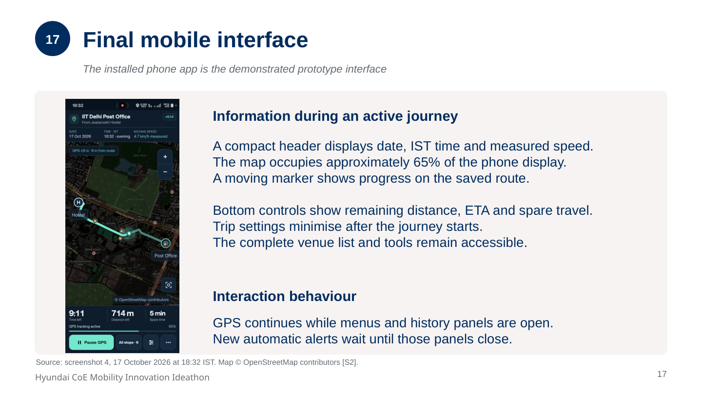
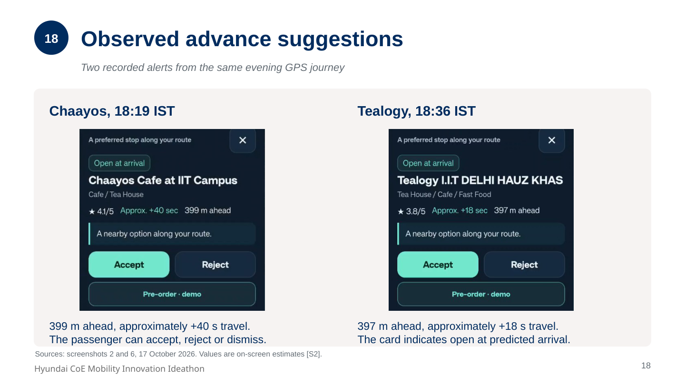
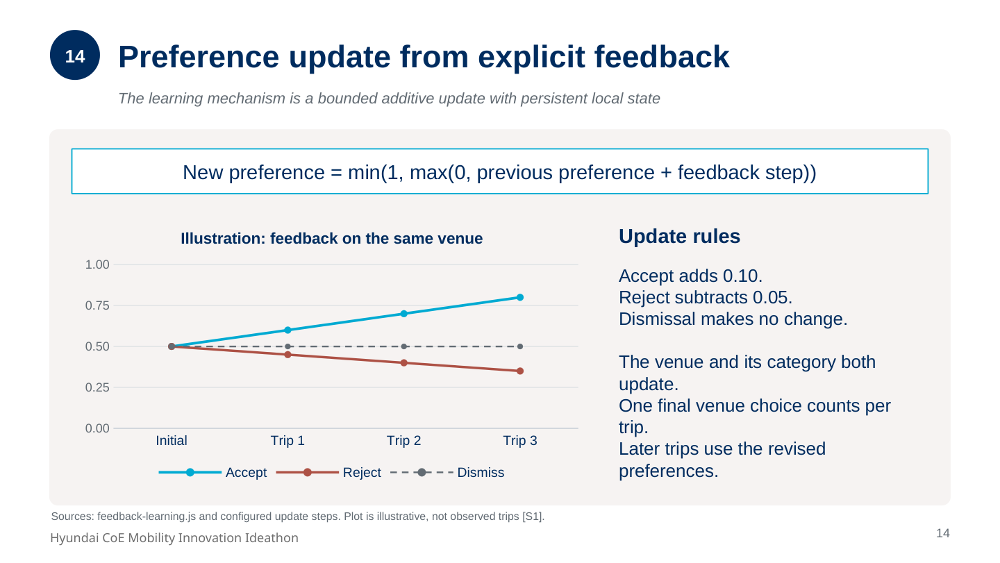

# Raaste Mein

**Food stop recommendation from route context and explicit feedback**

Raaste Mein is an installed-phone prototype that suggests an upcoming place to eat or drink during an existing journey. It uses the route, the current time, a spare-travel allowance and previous accept/reject choices. The passenger can accept a suggestion, reject it or continue without choosing.

**Author:** Manasjyoti Baishya, IIT Delhi  
**Entry:** Individual, Track B, AI powered & Digital In-Vehicle Experience  
**Prototype:** v5.1.0, frozen for the ideathon demonstration

The working demonstration runs as an installed Android progressive web app (PWA). The intended future setting is a passenger-facing vehicle display. The current implementation supports one direction on one campus route.

## Start here

- [Open the live app](https://manasjyoti-99.github.io/raaste-mein/) — use HTTPS on the phone, then install the PWA for the intended demonstration.
- [Watch the demonstration on YouTube](https://www.youtube.com/shorts/S3F9gqr6sio)
- [Technical report, PDF](docs/Raaste_Mein_Technical_Report.pdf)
- [Editable presentation, PowerPoint](docs/Raaste_Mein_Technical_Report.pptx)
- [System architecture and module responsibilities](docs/architecture.md)
- [Recommendation and learning methods](docs/methods.md)
- [Recorded demonstration and evidence boundaries](docs/evidence.md)
- [Running, installing and hosting the app](docs/deployment.md)
- [Original screenshot gallery](assets/screenshots/README.md)
- [Demonstration video notes](assets/video/README.md)
- [Future research proposal and evaluation plan](docs/future-research.md)

**Demo video:** [Watch Raaste Mein on YouTube](https://www.youtube.com/shorts/S3F9gqr6sio). The author-supplied recording is hosted externally; the [screenshot gallery](assets/screenshots/README.md), [evidence record](docs/evidence.md) and reproducible source are included here.

## Problem and scope

The initial motivation was finding cafés with friends while following an existing route, and considering meals during a busy routine. A nearby venue may already be behind the passenger, be closed at arrival or require more extra travel than available. The prototype combines those checks before issuing an advance suggestion.

These motivations come from the author's experience. The project does not claim a customer survey or a measured reduction in missed meals.

| Scope item | Current implementation |
| --- | --- |
| Route | Jwalamukhi Hostel to IIT Delhi Post Office |
| Direction | Hostel to post office |
| Route geometry | 183 points, 2,048.3 m, displayed as 2.05 km |
| Venue dataset | 9 saved food stops and 40 menu entries |
| Spare travel | User-selected allowance from 0 to 30 minutes |
| Automatic alerts | At most 2 per trip, at least 250 m apart |
| Feedback | Accept, Reject, or neutral dismissal |
| Persistent state | Local preferences and completed-trip metadata |
| Ordering | Simulated cart and receipt, with no restaurant fulfilment |

Saved hours, ratings and menu prices are demonstration inputs, not live restaurant feeds. Spare time covers estimated extra travel. It excludes preparation, waiting and eating duration.

## Installed mobile interface



The initial settings sheet allows the passenger to choose the mode and spare travel. After starting, the app shows a compact date/time/speed header, a large route map and bottom journey controls. The supplied final screenshots show v5.1.0 operating as an installed app.

## Advance suggestions



The two recorded cards show Chaayos 399 m ahead and Tealogy 397 m ahead. Their displayed extra-travel times are estimates from the geometric model. These frames are from the same evening GPS journey, not separate time-of-day experiments.

## Run locally on Windows

Keep `index.html`, the JavaScript files and all asset folders together at the repository root. Open a terminal in that folder:

```powershell
py -m http.server 8000 --bind 127.0.0.1
```

If the Python launcher is unavailable, use `python` instead of `py`. Open <http://localhost:8000/?v=5.1.0>.

No npm install, framework build, API key or recommendation server is required. Phone GPS and PWA installation use an HTTPS address. See [deployment instructions](docs/deployment.md) for the installed-phone workflow and the existing GitHub Pages deployment.

## Demonstration modes

**Replay** advances a marker along the saved route at a modelled 15 km/h. The passenger can select the replay date and departure time and use 1x, 2x or 4x playback. To inspect the configured baseline, choose 11:00 IST, 5 minutes spare travel and start without preselecting a venue. Existing preferences can change the ranking.

**Live GPS** uses trusted phone fixes, actual IST time and measured moving speed. Off-route or poor-quality fixes suspend alerts. The fixed campus route is required for a meaningful live demonstration. Outside that route, replay remains available. The current app pauses tracking when backgrounded.

## Recommendation method

1. Project each venue and the current location onto the closest route segment.
2. Check whether a venue is ahead, sufficiently close to the route, open and within the remaining travel allowance.
3. Rank eligible venues using preference, time-of-day fit, saved rating and estimated detour.
4. Issue an advance card when the selected venue reaches the configured approach window.
5. Retain explicit choices for later trips.

The ranking weights are preference 0.60, time fit 0.20, rating 0.10 and detour fit 0.10. They are configured rules, not fitted weights. [Methods](docs/methods.md) defines the equations and assumptions.

## Learning mechanism

Accept adds 0.10 and Reject subtracts 0.05 from both the venue and its assigned category preference. Values stay between 0 and 1. A close, timeout, outside tap or swipe causes no preference change. Each venue contributes one final choice per trip, and automatic suggestions use a snapshot of preferences from the start of that trip.



This graph illustrates the implemented update rule. It is not a plot of collected field results. Contextual remarks and routine detection use additional explicit conditions described in [methods](docs/methods.md).

## Available evidence

The supplied author export contains three completed GPS records and one explicit retained Accept event for Naivedyam at lunchtime. The original personal export remains with the author. This repository includes the documented summary and final-layout screenshots, not that personal backup.

The author also confirmed replay and learning demonstrations. The available export does not itself contain completed replay records or a matched routine. The evidence supports functional operation, without a controlled relevance study or measured detour-time error. See [evidence](docs/evidence.md).

The bundled `data/history.json` contains **ten synthetic sample trips** for the sample routine view. They are separate from real GPS trips and provide no food-choice feedback.

## Data and privacy

The app uses localStorage on the phone, scoped to its hosting origin and browser profile. It has no server database for trip history or learning. A backup contains explicit choices and completed-trip metadata, not a continuous GPS trajectory. Carts, current progress and simulated receipts are transient.

A normal app update on the same origin retains history. A different host or device needs the app's JSON backup/restore flow. A new GitHub Pages address will not automatically inherit records from the existing installed app.

## Repository contents

| Path | Contents |
| --- | --- |
| `index.html`, `style.css`, `app.js` | Final mobile interface and application coordination |
| `*-engine.js`, `feedback-learning.js`, `history-backup.js` | Recommendation, GPS, routine, menu and history logic |
| `data/` | Route, venues, configuration and explicitly synthetic sample history |
| `manifest.json`, `service-worker.js`, `pwa.js` | Installation, caching and app lifecycle |
| `vendor/leaflet/`, `icons/` | Bundled map library and app icons |
| `route/` | Original supplied route geometry in KML format |
| `assets/screenshots/` | Eight supplied final-layout images and an observation index |
| `assets/video/` | YouTube demonstration link and viewing notes |
| `docs/` | Technical report, diagrams, methods, evidence, deployment, provenance and proposed future research |

## Prototype limitations

The current implementation supports a fixed route and geometric travel estimates. It does not model actual side-road access, queues, preparation or eating time. Venue information is saved. Pre-orders are demonstrations. Vehicle display integration and a quantitative evaluation of recommendation quality are outside the implemented scope.

## Future research

The [future research plan](docs/future-research.md) proposes comparing a learned contextual preference model with the current fixed-weight method and a distance-based baseline. Its objectives and evaluation measures are planned work, separate from the implemented v5.1.0 prototype and its demonstration evidence.

## Attribution and provenance

The repository preserves the final app's application code, data and assets byte for byte. [Source integrity](docs/source-integrity.json) lists the runtime file hashes and the current `.nojekyll` publishing-marker hash. [Provenance](docs/provenance.md) documents that marker's harmless newline, the evidence and the package contents.

Leaflet is bundled with its [license](vendor/leaflet/LICENSE.txt). Map data attribution belongs to [OpenStreetMap contributors](https://www.openstreetmap.org/copyright). This project is an individual prototype, with no claimed restaurant or food-platform affiliation.
